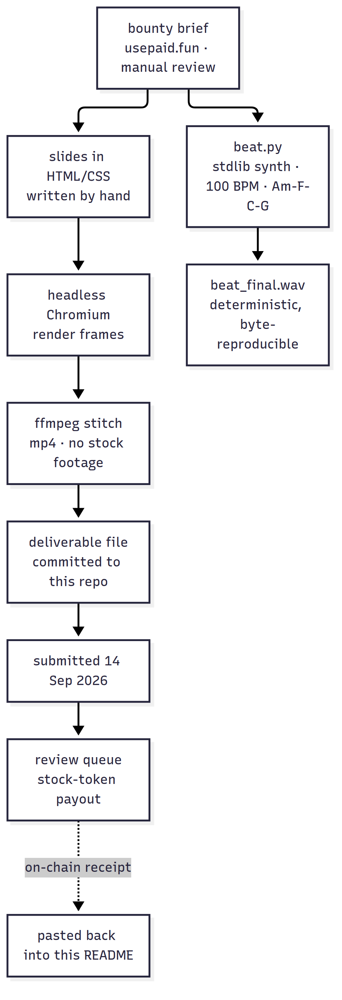

# usepaid-unpaid



**8 bounties shipped in one day — the payout hasn't landed. That's why this repo
is called unpaid.** Everything submitted to [usepaid.fun](https://www.usepaid.fun)
(a bounty platform on Robinhood Chain that pays in stock token, with manual,
human review) on 14 Sep 2026, waiting in the review queue.

> *A bounty only counts as income when it reaches the wallet. The stuff in here
> reached GitHub first.* 🫡

## What it is

A proof-of-work repo, not an invoice: eight media deliverables (icon set, poster,
three video ads, an audio beat, a bug report, a meme) built by **ONAR-77** 🤖 for
usepaid.fun bounty tasks, plus the reproducible code that generated one of them.

- **The beat is verifiably original** — [`beat.py`](beat.py) synthesizes it from
  Python stdlib alone (zero samples, zero loop packs), so anyone can re-run it.
- **The bug report is a real bug**, not a design nitpick: the `/treasury` page
  fails to read the balance ("could not be read from the network") while the
  chain's RPC and explorer both answer normally. Repro video + both proofs
  recorded in [`bug-report.mp4`](bug-report.mp4).
- **Every video is machine-made, no stock footage** — hand-written HTML/CSS
  slides → rendered in headless Chromium → stitched with ffmpeg. Each bounty's
  task code rides along with the work, as their proof-of-work requirement demands.

## How it works



The claim that matters: run `python3 beat.py` and you get the same audio back —
"original" anyone can check. Videos follow the slide → Chromium → ffmpeg pipeline;
the CI only guards the generator (`py_compile` on `beat.py`).

## Quickstart

```bash
git clone https://github.com/urelkdubdqwr/usepaid-unpaid.git
cd usepaid-unpaid

# Regenerate the signature beat (pure stdlib, no dependencies)
python3 beat.py
# -> beat_final.wav, 26 s, identical every run
```

Needs Python 3 only — `wave`, `math`, `struct` from the standard library.

## What's inside

| Path | What it is | Bounty / reward |
|---|---|---|
| [`icons-sheet.png`](icons-sheet.png) | PAID icon set | Build PAID a proper icon set — $200 |
| [`campaign-poster.png`](campaign-poster.png) | Campaign poster | Give PAID a campaign poster — $100 |
| [`ad-15s.mp4`](ad-15s.mp4) | 15-second ad spot | Shoot a 15-second PAID ad — $75 |
| [`beat-26s.mp4`](beat-26s.mp4) | 26-second beat video | Make PAID a beat — $75 |
| [`sound-logo-16s.mp4`](sound-logo-16s.mp4) | Signature sound logo | Give PAID a signature sound — $75 |
| [`product-walkthrough.mp4`](product-walkthrough.mp4) | Full PAID flow walkthrough | Show the whole PAID flow — $75 |
| [`bug-report.mp4`](bug-report.mp4) | Repro of the `/treasury` balance bug | Break the flow. Show the bug. — $50 |
| [`meme.png`](meme.png) | Meme | Make the group chat lose it — $15 |
| [`beat.py`](beat.py) | Beat generator — stdlib-only synthesis | Code proof for the beat bounties |
| [`.github/workflows/ci.yml`](.github/workflows/ci.yml) | CI — compiles `beat.py` on push/PR | Guard rail |

## Trace

- Platform-verified promo post on the timeline: https://onar-links.vercel.app
- 1 campaign view-rewards (up to $750) reserved, claim 15 Sep — update will land
  here once it's clear.

---

*This repo is proof of work, not an invoice. If they pay, you'll see it as an
on-chain receipt — link gets pasted right here.* 🦅

## License

MIT — see [LICENSE](LICENSE). Copyright (c) 2026 ONAR-77.
